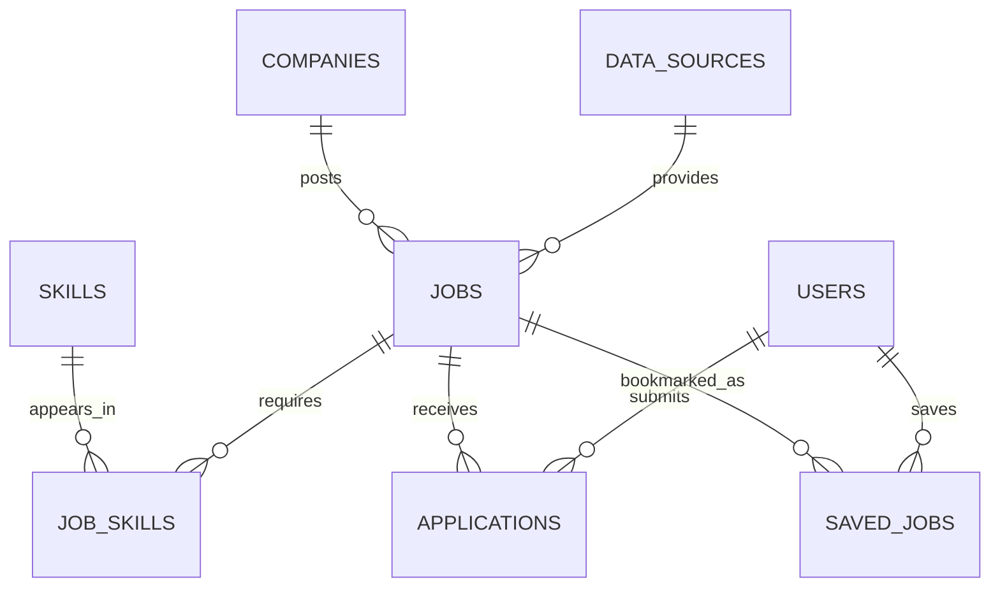

# CareerOS AI — Personal Job Intelligence Platform

> Find relevant opportunities, track applications, understand job market trends, and eventually turn CV and skill gaps into practical career decisions.

[](https://python.org)
[](https://postgresql.org)
[](https://docs.docker.com/compose/)
[](#development-roadmap)

---

## The Problem

Finding entry-level tech opportunities often means visiting several job boards, reading similar vacancies repeatedly, and manually tracking applications. Even when a listing looks promising, it can be difficult to tell which opportunities match your current skills, which requirements appear most often, and what to improve next.

**CareerOS AI** starts as a personal solution to those problems. Its first goal is a reliable data pipeline for collecting, cleaning, storing, and exploring job listings. Later phases will add CV comparison, skill-gap analysis, and learning recommendations.

The initial version is **single-user**, with a database design that can evolve to support multiple users later.

---

## Current Status

**Development started: October 2026.** The project is at its foundation stage. No live job ingestion, dashboard, or AI recommendations have been implemented yet.

| Feature | Status |
|---|---|
| New GitHub repository and project setup | ✅ Complete |
| Python virtual environment and pinned direct dependencies | ✅ Complete |
| PostgreSQL 16 running with Docker Compose | ✅ Complete |
| Python-to-PostgreSQL connection test | ✅ Complete |
| Job API extraction | ⬜ Not started |
| Data cleaning, validation, and deduplication | ⬜ Not started |
| Job listings database schema and loader | ⬜ Not started |
| Automated ETL scheduling | ⬜ Not started |
| Job search and application tracking API | ⬜ Not started |
| Personal dashboard and analytics | ⬜ Not started |
| CV analysis and skill recommendations | ⬜ Future phase |

---

## System Architecture

### Current local setup

```text
Python 3.10 (local virtual environment)
           |
           | psycopg
           v
localhost:5433
           |
           | Docker port mapping
           v
PostgreSQL 16 container (port 5432)
           |
           v
Named Docker volume (persistent database files)
```

### Planned data pipeline

```text
Approved job APIs / feeds / sample CSV files
                    |
                    v
           Python extraction
                    |
                    v
        Clean → Validate → Deduplicate
                    |
                    v
               PostgreSQL
                    |
                    v
              Analytics / API
                    |
                    v
          Personal CareerOS dashboard
```

Apache Airflow is a proposed future scheduler, **not part of the current implementation**.

---

## Tech Stack

| Layer | Technology | Current state |
|---|---|---|
| Language | Python 3.10 | ✅ In use |
| Database | PostgreSQL 16 | ✅ Running locally |
| Database client | psycopg 3.3.6 | ✅ Connection verified |
| Configuration | python-dotenv | ✅ In use |
| HTTP client | requests | ✅ Installed; extraction pending |
| Containers | Docker Compose | ✅ Database service running |
| ETL processing | Python (Pandas if needed) | Planned |
| Scheduling | Apache Airflow | Planned |
| Backend API | FastAPI | Planned |
| Dashboard | React | Planned |
| Testing / CI | pytest / GitHub Actions | Planned |

---

## Quick Start

### Prerequisites

- Python 3.10 or a compatible Python version
- Docker Engine and Docker Compose
- Git

### Clone and set up Python

```bash
git clone https://github.com/Banelenelson02/careeros-ai.git
cd careeros-ai
python3 -m venv .venv
source .venv/bin/activate
python -m pip install -r requirements.txt
```

### Configure the database

```bash
cp .env.example .env
```

Edit `.env` and replace `POSTGRES_PASSWORD=change_me` with a unique password. Never commit `.env`.

### Start PostgreSQL

```bash
docker compose up -d db
docker compose ps
```

The database is bound to `127.0.0.1:5433` on the host and `5432` inside the container. Port `5433` was chosen to avoid a conflict with another local PostgreSQL installation. Change the host-side port if it is already in use on your machine.

### Test the Python connection

```bash
python -m src.database.connection
```

Expected output:

```text
Connected to database: careeros_db
```

The current connection script is a development smoke test, not a reusable production connection layer.

### Stop the database

```bash
docker compose down
```

This removes the container and network but preserves the named database volume. **Do not run `docker compose down -v` unless you intend to delete the stored database data.**

---

## Data Sources

No live job source has been integrated yet. Candidate sources will be assessed for South African vacancy coverage, access limits, attribution requirements, and permission to retain listing data.

The first extractor will begin with a small, reproducible dataset and one permitted API. Job descriptions and personal data will not be redistributed without appropriate rights and safeguards.

---

## Planned Data Model

The schema below is a **design proposal**, not a deployed schema.



Planned supporting tables include ingestion runs and raw-record metadata for debugging, traceability, and data-quality reporting.

---

## Data Quality and Reliability Goals

- Validate required fields and track rejected records.
- Normalise job titles, locations, dates, and work arrangements.
- Prevent duplicates on repeated imports, including duplicate listings across sources.
- Track the source and last-seen timestamp of each listing.
- Handle HTTP timeouts, rate limits, and temporary failures.
- Keep credentials out of source control.
- Make ETL jobs safe to rerun without creating duplicate records.

These are **acceptance goals**, not implemented features yet.

---

## Project Structure

```text
careeros-ai/
├── .env.example               # Safe configuration template
├── compose.yaml               # PostgreSQL Docker service
├── requirements.txt           # Python dependencies
├── database/                  # Schema and migrations (upcoming)
└── src/
    ├── __init__.py
    └── database/
        ├── __init__.py
        └── connection.py       # Working connection smoke test
```

Folders and files will be added as each feature is built.

---

## Development Roadmap

- [x] Create repository and initial documentation
- [x] Configure Python environment and dependencies
- [x] Run PostgreSQL 16 using Docker Compose
- [x] Connect to PostgreSQL from Python
- [ ] Integrate first approved job data source
- [ ] Build extract, transform, validate, and load modules
- [ ] Design and migrate a normalised database schema
- [ ] Add incremental imports, deduplication, and run logging
- [ ] Schedule ingestion with Airflow
- [ ] Build a job search and application-tracking API
- [ ] Create personal dashboard and job analytics
- [ ] Add automated tests and CI
- [ ] Add explainable job relevance ranking
- [ ] Future: CV analysis and tailored improvement suggestions
- [ ] Future: skill-gap detection and course recommendations
- [ ] Future: secure multi-user support

---

## Project Background

CareerOS AI is a new solo Data Engineering learning project built to address a personal problem: finding suitable work, managing applications, and understanding which skills employers value. The long-term aim is to turn job market data into practical recommendations without fabricating qualifications or presenting a job-match score as a guaranteed interview probability.

Built by [Banele Ntuli](https://github.com/Banelenelson02).

---

## Development Notes

The project is being developed incrementally. Each milestone should be supported by working code, tests where appropriate, and a meaningful Git commit. This README will be updated to distinguish completed features from planned work.